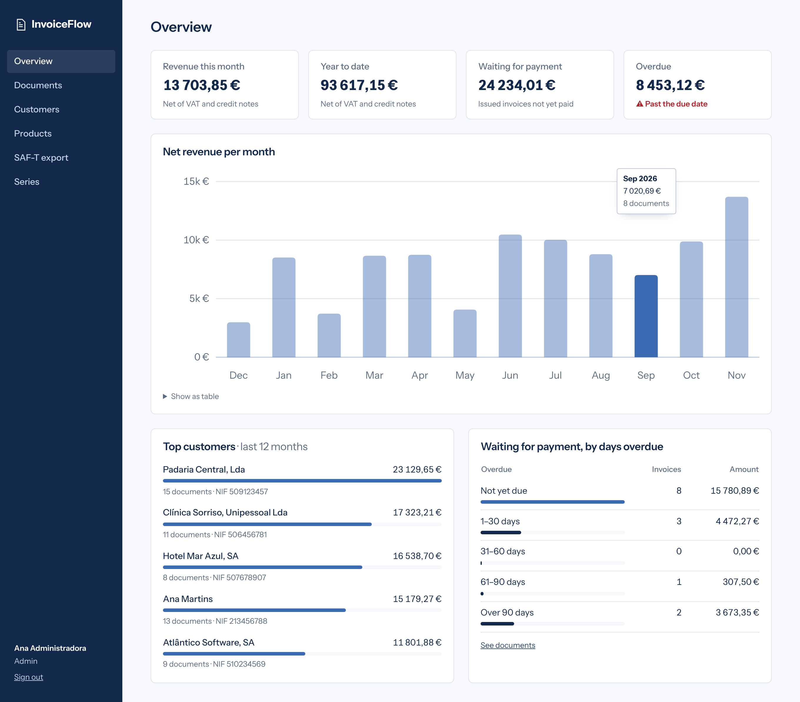
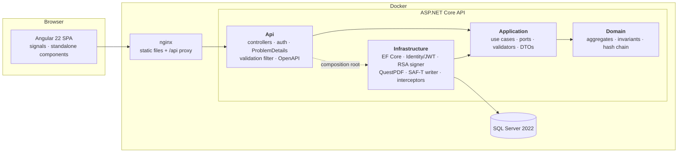
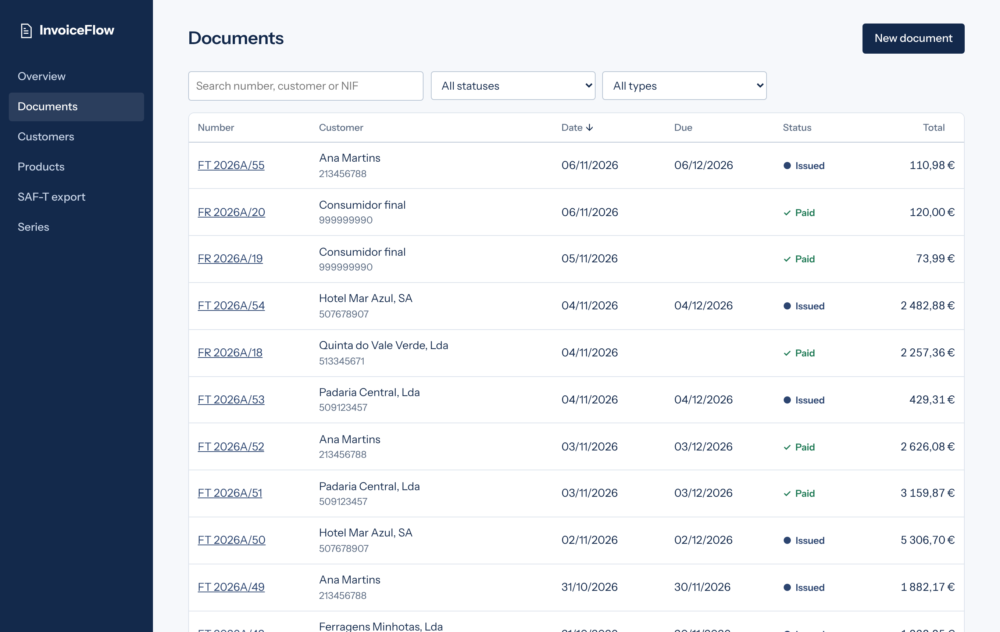
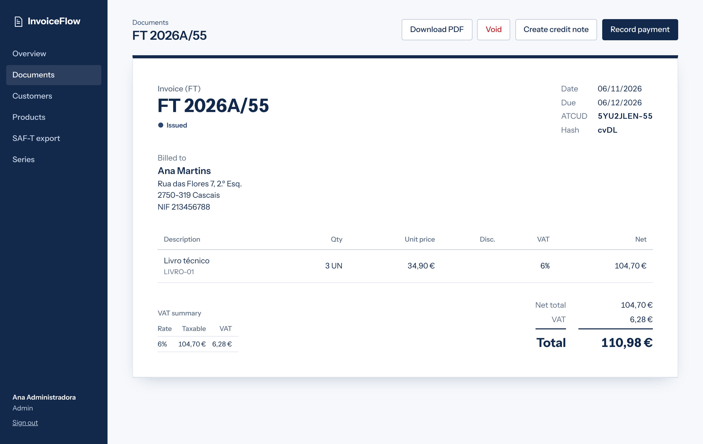
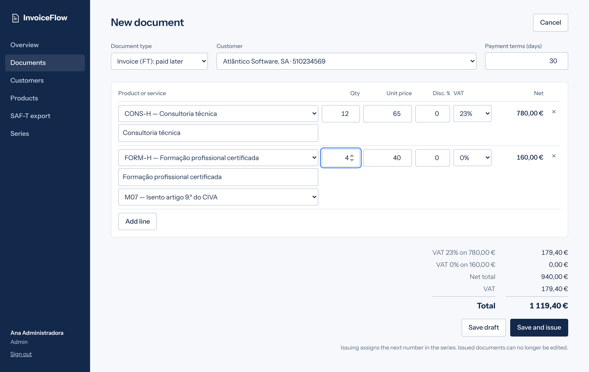
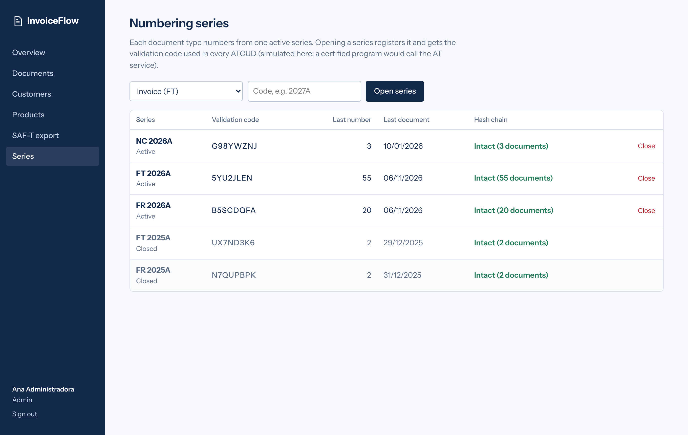

# InvoiceFlow

A small invoicing ERP for Portuguese SMEs: customers, products, VAT, invoices, invoice-receipts and
credit notes with sequential numbering, a signed hash chain, ATCUD, PDF with the AT QR code, SAF-T (PT)
export and a dashboard.

Built with **.NET 10**, **EF Core / SQL Server**, **Angular 22** and **Clean Architecture**, as a
portfolio project. The code, the tests and the [architecture decision records](docs/adr) matter as
much as the features.

> [!IMPORTANT]
> **InvoiceFlow is not certified invoicing software.** The hash chain, ATCUD, QR code and SAF-T export
> follow the structure of the Autoridade Tributária (AT) rules, but series communication is simulated,
> there is no AT certificate, and documents produced here have no fiscal validity. See
> [ADR 0004](docs/adr/0004-hash-chain-and-atcud.md) for exactly what is and is not implemented.



## Features

| Area | What it does |
|---|---|
| **Customers** | Portuguese NIF validation (mod-11 check digit), anonymous "Consumidor final", unique NIF, soft delete |
| **Catalog** | Goods and services with default VAT rate; rates 23 / 13 / 6 % and exempt with a legal exemption reason (M01–M99) |
| **Documents** | Invoices (FT), invoice-receipts (FR) and credit notes (NC); draft → issued → paid / voided; issued documents are immutable |
| **Numbering** | Per-series sequential numbers without gaps, safe under concurrent issuing, dates never go backwards in a series |
| **Compliance-inspired** | RSA-signed hash chain per series with tamper detection, ATCUD, AT QR code, hash excerpt on documents |
| **Credit notes** | Created from an issued invoice, line by line; never more than what remains creditable |
| **PDF** | A4 invoice with QuestPDF, including the AT QR code |
| **SAF-T (PT) 1.04_01** | Export of a period, validated against the official AT schema in the test suite |
| **Dashboard** | Net revenue per month, top customers, unpaid amounts by days overdue |
| **Lists** | Server-side paging, filtering and sorting |
| **Security** | ASP.NET Core Identity, JWT access tokens + rotating refresh tokens (HttpOnly cookie), roles Admin / Accountant / Viewer |
| **Auditing** | CreatedBy / UpdatedAt on every entity through an EF Core interceptor |

## Run it

Requirements: Docker. Host ports used: **5100–5102** only.

```bash
docker compose up --build
```

| URL | What |
|---|---|
| http://localhost:5100 | Web app |
| http://localhost:5101/scalar | API reference (Scalar) |
| `localhost,5102` | SQL Server (`sa` / `InvoiceFlow!2026`, demo only) |

On first start the API applies the migrations and seeds a year of demo activity, all of it created
through the domain model (numbered, signed and valid in SAF-T).

| Demo account | Password | Can |
|---|---|---|
| `admin@invoiceflow.local` | `Admin!2026` | everything, including numbering series |
| `accountant@invoiceflow.local` | `Accountant!2026` | create, issue, pay, void, credit, export SAF-T |
| `viewer@invoiceflow.local` | `Viewer!2026` | read only |

### Without Docker for the apps

```bash
docker compose up -d db                                         # SQL Server on localhost,5102
dotnet run --project src/InvoiceFlow.Api --launch-profile http  # API on http://localhost:5101
```

```bash
cd web && npm ci && npm start                                   # Angular on http://localhost:5103, proxies /api
```

### Tests

```bash
dotnet test        # unit, architecture and integration tests (integration tests need Docker)
```

```bash
cd web && npm test
```

The integration tests start a real SQL Server with Testcontainers and exercise the API end to end
through `WebApplicationFactory`, with real JWTs.

## Architecture



Dependencies point inwards: **Domain** references nothing, **Application** knows no EF Core or
ASP.NET Core, and an architecture test fails the build if that ever changes.

```
src/
  InvoiceFlow.Domain/          Invoice aggregate, DocumentSeries, Customer (NIF), Product, TaxRate, HashChain
  InvoiceFlow.Application/     One class per use case (IssueInvoice, CreateCreditNote, …), ports, validators
  InvoiceFlow.Infrastructure/  AppDbContext + migrations, repositories, read queries, interceptors,
                               Identity/JWT, RSA signer, QuestPDF renderer, SAF-T exporter, demo seeder
  InvoiceFlow.Api/             Controllers, Program.cs (composition root)
tests/
  InvoiceFlow.Domain.UnitTests/        totals and VAT rounding, state transitions, numbering, hash chain
  InvoiceFlow.Application.UnitTests/   use cases with NSubstitute, validators, AT QR payload
  InvoiceFlow.Architecture.Tests/      layer dependency rules (plain reflection)
  InvoiceFlow.Api.IntegrationTests/    HTTP + SQL Server (Testcontainers), SAF-T XSD validation
web/                                   Angular app
docs/adr/                              architecture decision records
```

### Issuing a document

```mermaid
sequenceDiagram
    actor User
    participant C as InvoicesController
    participant U as IssueInvoice (use case)
    participant I as Invoice (aggregate)
    participant S as DocumentSeries
    participant DB as SQL Server

    User->>C: POST /api/invoices/{id}/issue
    C->>U: HandleAsync(id)
    U->>DB: load draft + active series
    U->>I: Issue(series, today, now, signer)
    I->>I: check status, lines, series type,<br/>final-consumer limit, date order
    I->>S: ReserveNextNumber(date)
    I->>I: ATCUD + sign(date;entry;number;total;previous hash)
    I->>S: RecordHash(hash)
    U->>DB: SaveChanges (one transaction,<br/>rowversion check on the series)
    alt another issue won the race
        DB-->>C: concurrency conflict → 409, client retries
    else
        C-->>User: 200 issued document
    end
```

## Technical decisions

Each decision has a short ADR with context, alternatives and consequences.

| ADR | Decision |
|---|---|
| [0001](docs/adr/0001-clean-architecture-with-rich-domain.md) | Clean Architecture with a rich domain model; invariants live in the aggregates |
| [0002](docs/adr/0002-use-case-classes-instead-of-mediatr.md) | Plain use-case classes instead of MediatR (now commercial) and no handler interfaces |
| [0003](docs/adr/0003-document-numbering-strategy.md) | Numbers assigned at issue time; optimistic concurrency on the series row plus a unique index |
| [0004](docs/adr/0004-hash-chain-and-atcud.md) | Hash chain and ATCUD modelled on AT rules, and what is deliberately not compliant |
| [0005](docs/adr/0005-errors-result-pattern-and-problem-details.md) | Expected failures as `Result<T>` mapped to RFC 9457 ProblemDetails |
| [0006](docs/adr/0006-persistence-boundaries.md) | Repositories for writes, projections for reads, manual mapping, interceptors for audit and soft delete |
| [0007](docs/adr/0007-jwt-with-rotating-refresh-tokens.md) | JWT in memory + rotating refresh token in an HttpOnly cookie, with reuse detection |

A few choices worth calling out:

- **Lean dependencies.** No MediatR, AutoMapper, MassTransit or FluentAssertions (commercial licences),
  and nothing added that the code did not need: no Scrutor, no Respawn, no UI kit, no chart library.
  Tests use xUnit v3, Shouldly and NSubstitute.
- **Money.** `decimal` everywhere, line totals rounded half away from zero, VAT rounded once per rate
  (not per line); the Angular live preview mirrors the same rule and is tested against the same examples.
- **Dates.** "Today" and the signed system entry time are Portuguese local time, not the server's UTC.
- **Defence in depth.** The aggregate refuses changes to issued documents, an EF Core interceptor refuses
  to persist them, and the hash chain detects changes made directly in SQL.
- **SAF-T.** Written with `XmlWriter` in the element order of the official XSD, encoded in Windows-1252
  as AT requires, and validated against that XSD in the integration tests (with a negative test proving
  the validation really runs).

## Screenshots

| | |
|---|---|
|  |  |
|  |  |

## Licence

MIT. QuestPDF is used under its Community licence (free for individuals and organisations under USD 1M
annual revenue).
